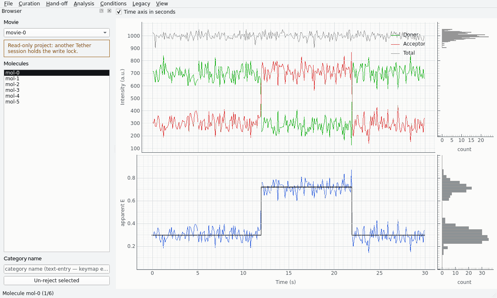
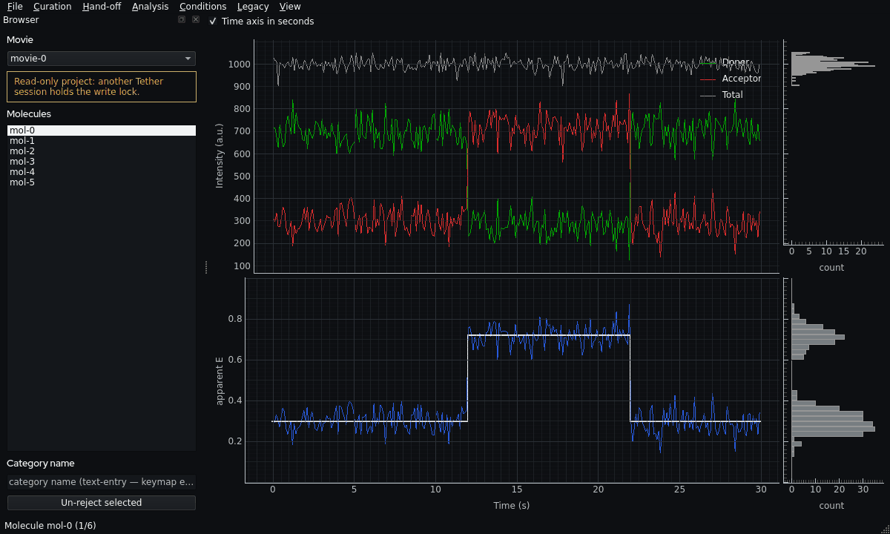
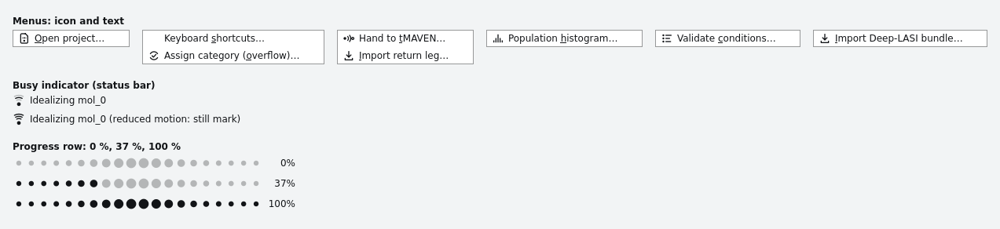
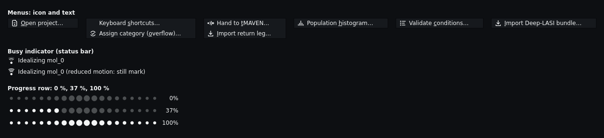

<!--
SPDX-FileCopyrightText: 2026 The Tether Authors <bioedca@u.northwestern.edu>
SPDX-License-Identifier: GPL-3.0-or-later
-->

# Window themes and trace colors

**Who this page is for.** Anyone who uses the Tether window and wants to change its theme, or
who wants to know the trace colors and how they were checked. It assumes you can open the
Tether window. It does not assume you know Qt or color science.

The Tether window has a light theme and a dark theme. This page tells you how to select a
theme, and it records the colors of the traces and how they were checked.

## Select a theme

At the start, Tether uses the light or dark scheme of your operating system. When the
operating system changes its scheme, the window changes too.

To select a theme yourself, use **View → Theme**:

| Item | Result |
|---|---|
| System | The window follows the operating system. This is the default. |
| Light | The window is always light. |
| Dark | The window is always dark. |

The window, the plots and the movie viewer change immediately. You do not have to start
Tether again. Tether keeps your selection until you close it. A later version keeps it
for the next session ([#330](https://github.com/bioedca/tether/issues/330)).

If the operating system does not report a scheme, the System item gives the light theme.

The two pictures show a synthetic trace, not measured data. They were made on Linux with
the offscreen Qt platform.

## What the theme changes

- **The window.** Tether uses the Qt Fusion style on all operating systems, with the colors
  of the theme. The selected item is ink on light, or chalk on dark. The brand has no
  accent color.
- **The plots.** The background, the axes, the grid and the labels of each plot take the
  colors of the theme. No plot has a black background in the light theme.
- **The movie viewer.** The napari viewer uses its own `light` or `dark` theme.
- **Section titles.** Section titles use Red Hat Display. Body text, tables and numbers
  use the system font. If Tether cannot load the font files, it uses the system font
  and writes one line in the log.

The theme does not change the figures that Tether exports. Exported figures are made
with Matplotlib and have no brand element ([ADR-0044](../adr/0044-matplotlib-base-plot-export-backend.md)).

The window colors are the tokens in `src/tether/gui/assets/brand/tokens.json`
(see [Brand](../brand.md)). The module `tether.gui.theme` is the only module in
`src/tether/gui` that contains a color value. A test makes sure of this.

## Icons and progress cues

The interface icons come from the brand kit ([Brand](../brand.md)). Each icon has a light
version (ink) and a dark version (chalk), and the icons change with the theme.

**Menus.** These menu items show an icon beside their text:

| Menu item | Icon |
|---|---|
| File → Open project | project |
| Curation → Assign category | curate |
| Hand-off → Hand to tMAVEN | hand-off |
| Hand-off → Import return leg | import |
| Import → Deep-LASI bundle | import |
| Analysis → Population histogram | analyze |
| Conditions → Validate conditions | conditions |

An icon is never the only sign of a function. Each menu item keeps its text.

**Busy indicator.** When a task runs and does not give a percentage, the right end of the
status bar shows the busy indicator and the name of the task. Today this task is the
one-click idealize (the `I` key). The task name uses the molecule name from the molecule
list, for example `Idealizing mol-3`. The three wavefronts of the mark light in sequence, from
the surface to the molecule. The indicator stops when the task stops.

If your operating system asks for reduced motion, the wavefronts do not move. The
indicator then shows the still mark and the name of the task. Tether reads this setting
each time a task starts:

| Operating system | Setting |
|---|---|
| Windows | Animation effects is off (Windows 11: Settings → Accessibility → Visual effects) |
| macOS | Reduce motion is on (System Settings → Accessibility → Display) |
| Linux (GNOME) | Animations are off (`org.gnome.desktop.interface enable-animations` is false) |

On a Linux desktop other than GNOME, Tether cannot read the setting, and the wavefronts
move.

**Progress row.** The progress row is a row of beam dots for a task that gives a
percentage. The dots fill from left to right, and the percentage is beside the row.
Assistive technology reads the row as a progress bar with its value. In this version, no
task gives a percentage, so the window does not show the row. The task service and the
progress panel of a later version put the row in the window
([#343](https://github.com/bioedca/tether/issues/343),
[#627](https://github.com/bioedca/tether/issues/627)).

The two pictures were made on Linux with the offscreen Qt platform.

## Trace colors

The colors of data are not brand colors. Tether has two sets of trace colors. Each set
has one value for each theme.

- **Classic** is the set that Tether used before: green donor, red acceptor, blue FRET,
  grey total. It is the default. The idealized line is now ink on light and chalk on
  dark. Before, it was near-black on a black plot and you could not see it
  ([#617](https://github.com/bioedca/tether/issues/617)).
- **Safe** is a set for persons with a color-vision deficiency. A later change makes it
  the default and adds a preference ([#636](https://github.com/bioedca/tether/issues/636)).

| Token | Classic, light | Classic, dark | Safe, light | Safe, dark |
|---|---|---|---|---|
| Donor | `#00aa00` (3.0 : 1) | `#00aa00` (6.2 : 1) | `#228833` (4.4 : 1) | `#009e73` (5.6 : 1) |
| Acceptor | `#dc2d2d` (4.6 : 1) | `#dc2d2d` (4.1 : 1) | `#aa3377` (5.9 : 1) | `#cc79a7` (6.3 : 1) |
| FRET | `#285adc` (5.7 : 1) | `#285adc` (3.3 : 1) | `#4477aa` (4.5 : 1) | `#56b4e9` (8.3 : 1) |
| Total | `#8c8c8c` (3.2 : 1) | `#8c8c8c` (5.7 : 1) | `#343a40` (11.1 : 1) | `#d5dadd` (13.6 : 1) |
| Idealized | `#121417` (17.8 : 1) | `#f2f4f5` (17.4 : 1) | `#121417` (17.8 : 1) | `#f2f4f5` (17.4 : 1) |

The ratio is the WCAG 2.x contrast against the plot background of the theme (`#fbfbfa`
light, `#0d0f12` dark). Each trace color has a contrast of 3 : 1 or more. Each text
color of the window has a contrast of 4.5 : 1 or more.

### Sources of the safe set

- **Light:** donor, acceptor and FRET are green, purple and blue of Paul Tol's "bright"
  set. The values are from the `tol-colors` package, version 2.2.0, `colorsets.bright`.
- **Dark:** donor, acceptor and FRET are bluish green, reddish purple and sky blue of the
  Okabe–Ito set. The values agree with Wong, B. (2011), *Points of view: Color
  blindness*, Nature Methods 8, 441, [doi:10.1038/nmeth.1618](https://doi.org/10.1038/nmeth.1618),
  and with the `Colorblind8` palette of the `bokeh` package, version 3.6.3.
- **Total and idealized:** brand neutrals (`neutral-700` and ink on light,
  `neutral-200` and chalk on dark).

### Color-vision check of the safe set

The test `tests/test_gui_theme.py` simulates protanopia, deuteranopia and tritanopia.
It uses the model of Machado, Oliveira and Fernandes (2009), IEEE TVCG 15(6), 1291–1298,
[doi:10.1109/TVCG.2009.113](https://doi.org/10.1109/TVCG.2009.113), at severity 1.0. The
matrices agree with `colorspacious` 1.1.2. Then the test calculates the CIEDE2000 color
difference (Sharma, Wu and Dalal 2005, [doi:10.1002/col.20070](https://doi.org/10.1002/col.20070))
between each two colors in one plot: donor, acceptor and total in the intensity plot, and
FRET and the idealized line in the FRET plot.

Each pair must have a difference of 10 or more. Palettailor uses the same limit for
categorical colors (Lu et al. 2021, [doi:10.1109/TVCG.2020.3030406](https://doi.org/10.1109/TVCG.2020.3030406)).
This limit is a design decision of Tether, not a law of perception.

The smallest difference for each vision type:

| Vision | Safe, light | Safe, dark |
|---|---|---|
| Normal | 28.7 (acceptor and total) | 26.5 (FRET and idealized) |
| Protanopia | 14.8 (acceptor and total) | 23.6 (FRET and idealized) |
| Deuteranopia | 17.1 (acceptor and total) | 15.9 (donor and acceptor) |
| Tritanopia | 25.4 (acceptor and total) | 26.4 (acceptor and total) |

The first proposal for the total color was `#68717a` (light) and `#8d969c` (dark). These
colors failed the check: with deuteranopia, the total and the acceptor had a difference of
2.0 (light) and 2.5 (dark). Thus the total color changed to `#343a40` and `#d5dadd`. A test
keeps this result.

The classic set does not pass this check. With deuteranopia, the green donor and the red
acceptor have a difference of 5.0. This is the reason for #636.
